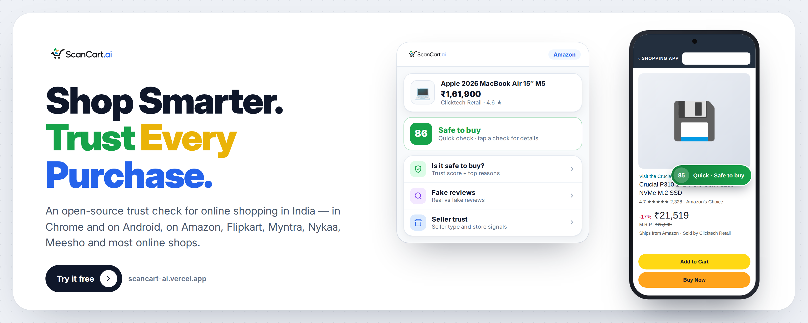
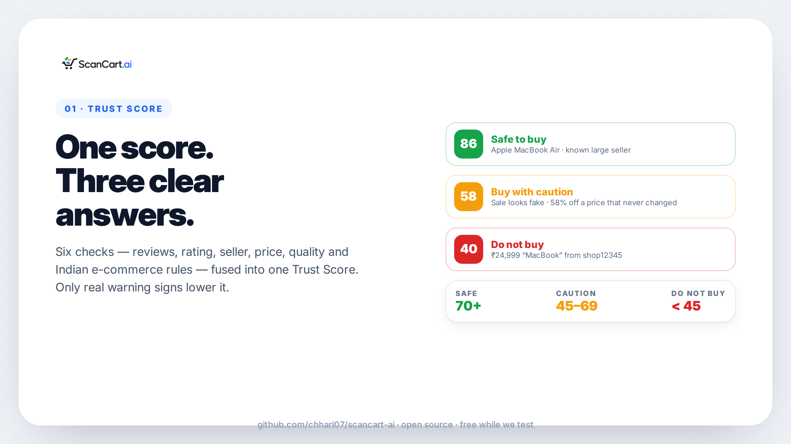
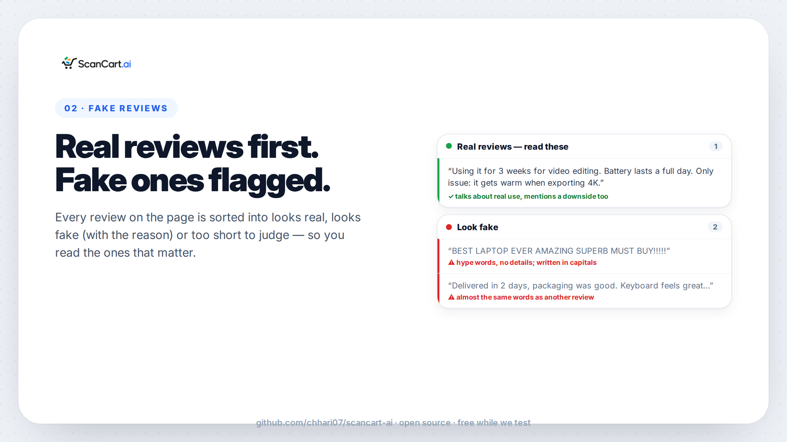
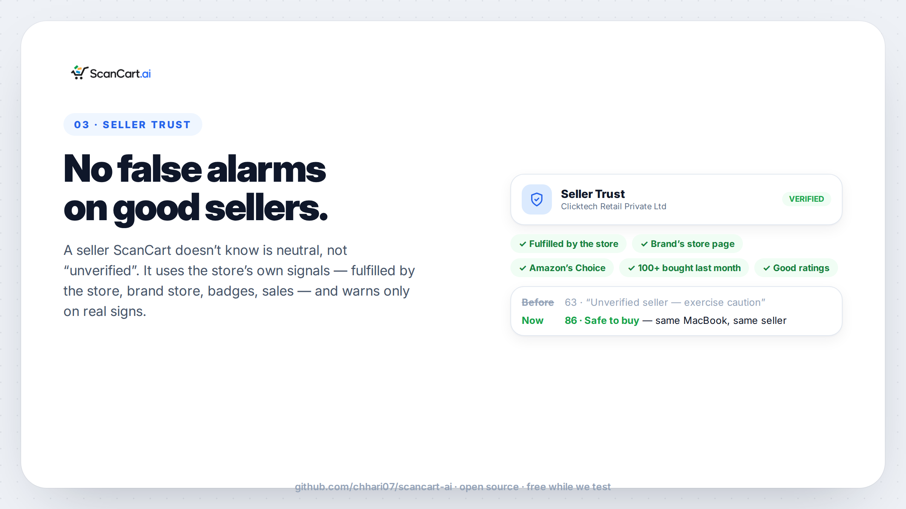
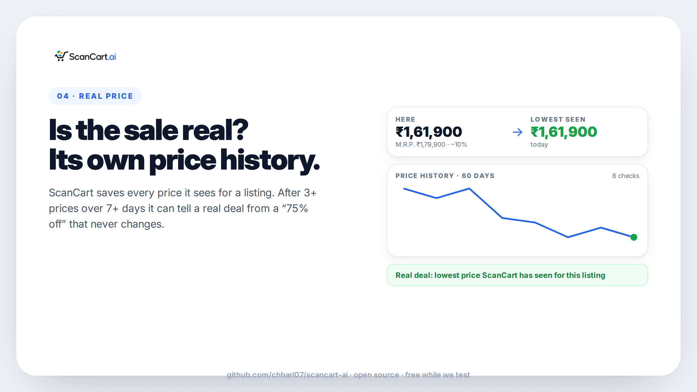
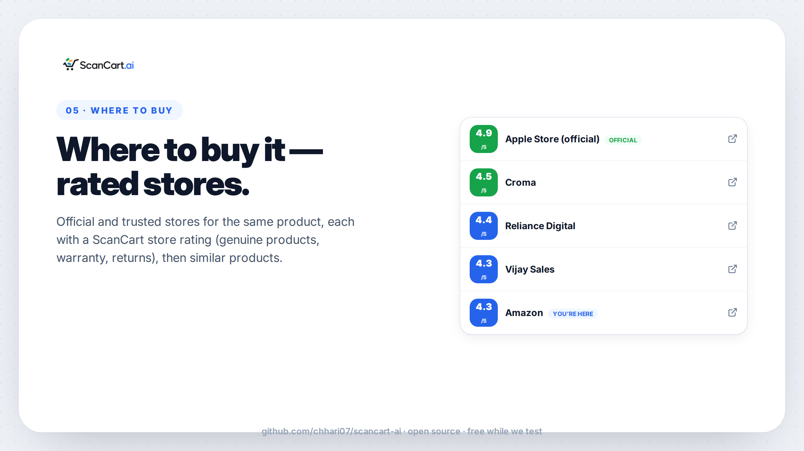
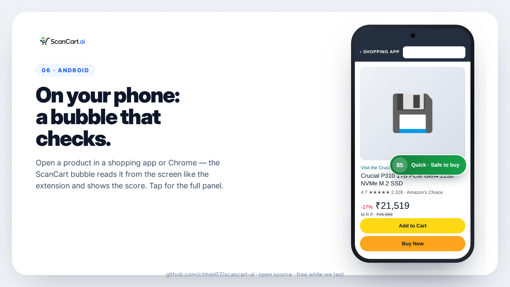
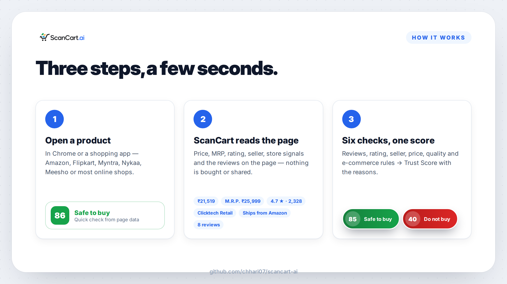
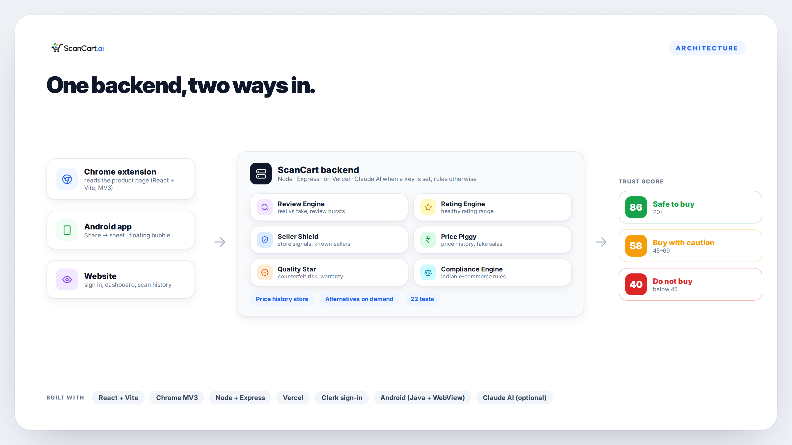
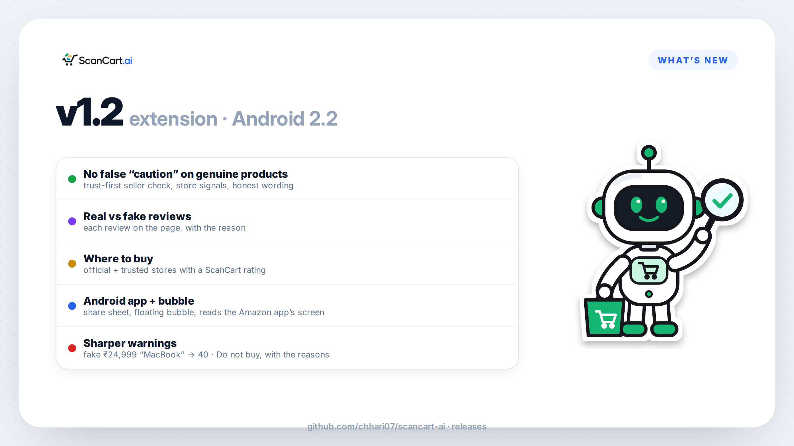

<p align="center">
  
</p>

<p align="center">
  <b>A trust check for online shopping in India — in Chrome and on Android.</b><br>
  Trust score · real vs fake reviews · seller · real price · where to buy
</p>

<p align="center">
  <a href="https://scancart-ai.vercel.app">Website</a> ·
  <a href="#run-it-yourself">Run it yourself</a> ·
  <a href="#how-it-works">How it works</a> ·
  <a href="https://github.com/chhari07/scancart-ai/releases">Releases</a> ·
  <a href="https://amankumarchhari.vercel.app/work/scancart">Case study</a>
</p>

---

## What it does

Open a product on Amazon, Flipkart, Myntra, Nykaa, Meesho — or most other online shops — and ScanCart tells you, in a few seconds, whether it looks safe to buy and **why**.

| | |
|---|---|
|  |  |
|  |  |
|  |  |

- **One Trust Score** — six checks (reviews, rating, seller, price, quality, Indian e-commerce rules) fused into one score: **70+ safe · 45–69 caution · below 45 do not buy**. Only real warning signs lower it; a seller ScanCart doesn't know is neutral, not "bad".
- **Real vs fake reviews** — every review on the page is sorted into *looks real*, *looks fake* (with the reason) or *too short to judge*.
- **Seller trust** — uses the store's own signals: fulfilled by the store, brand store, Amazon's Choice / Flipkart Assured, sales, ratings.
- **Real price** — ScanCart saves every price it sees for a listing; after 3+ prices over 7+ days it can tell a real deal from a "75 % off" that never changes.
- **Where to buy** — official and trusted stores for the same product, each with a ScanCart store rating.
- **Android** — share any product to ScanCart, or let the floating bubble read the product on screen and show its score *(in testing)*.

## How it works





| Folder | What |
|---|---|
| `extension/` | Chrome extension (Manifest V3, React + Vite): reads the product page, shows the on-page panel and the toolbar popup |
| `backend/` | Node + Express API (deployed on Vercel): the six checks, Trust Score, price history, alternatives |

The checks run on rules by default. Set `ANTHROPIC_API_KEY` and they are enhanced with Claude.

## Run it yourself

**Backend**
```bash
cd backend
cp .env.example .env        # ANTHROPIC_API_KEY is optional
npm install
npm start                   # http://localhost:4000
npm test                    # 22 tests
```

**Chrome extension**
```bash
cd extension
npm install
npm run build               # → extension/dist
```
Then open `chrome://extensions`, turn on **Developer mode**, **Load unpacked** → `extension/dist`.
The build talks to the live backend; set `VITE_BACKEND_URL=http://localhost:4000` before `npm run build` to use your own.

## What's new



## Status

ScanCart is free while we test. Scores are a guide, not a guarantee — always read the reasons.

## Built by

[Aman Kumar Chhari](https://amankumarchhari.vercel.app) (SOLOX), solo: extension, Android app, backend and checks. Selected pitch (Top 35), Rajasthan AI Builders Pitch-a-Thon 2026, Jaipur.

## License

[MIT](LICENSE) — free to use, change and share.
